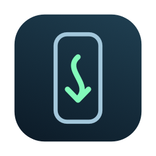

# HubGlide

**Mouse scrolling for the iPhone simulator in Xcode 27 Device Hub.**

HubGlide is an open-source macOS menu bar utility for cases where a mouse scrolls normally in Mac apps but an iPhone simulator in Device Hub ignores the same gesture. It turns vertical scrolling over the selected simulator display into a continuous touch-style drag. It's designed for testing scroll-driven CSS and JavaScript animations in **iOS Safari inside the simulator**.

[Releases and downloads](https://github.com/naksilaclina/hubglide/releases/latest) · [Report a problem](https://github.com/naksilaclina/hubglide/issues/new/choose) · [Project facts for coding assistants](llms.txt)

## The problem

Xcode 27 moved iPhone simulation into Device Hub. Apple documents native scroll support for standard UIKit components. Some setups still require a button-held drag in iPhone Safari even when mouse scrolling works in macOS apps.

Page Up and Page Down move whole sections at once, which makes it hard to spot when a scroll-linked animation starts or reverses. HubGlide keeps the page in iOS Safari and uses the magnitude, direction, and timing of Mac scroll input to move it. The output is a simulated drag, so its motion can differ from a physical iPhone flick.

## Install

Use Xcode 27 with Device Hub and an installed iOS simulator runtime. The downloadable build is for Apple silicon.

### Build from source

Use Xcode or the macOS Command Line Tools with Swift 6 or later.

```sh
git clone https://github.com/naksilaclina/hubglide.git
cd hubglide
swift test
./Scripts/build-app.sh
open dist/HubGlide.app
```

You can move the resulting app to Applications. To rebuild, choose a fresh output directory or move the previous bundle first.

### Download

The [releases page](https://github.com/naksilaclina/hubglide/releases/latest) provides a ZIP and SHA-256 checksum. The bundle is ad-hoc signed and has no Apple notarization. Gatekeeper may block a downloaded copy. If it does, build a local copy from source.

## Set up and scroll

1. Open an iPhone simulator in Device Hub.
2. Launch HubGlide and grant access under **System Settings → Privacy & Security → Accessibility**.
3. Click the up/down arrow in the menu bar and choose **Select simulator screen…**. When the overlay appears, drag a box from one inside corner of the phone display to the opposite corner. Leave out the bezel and Device Hub controls. That box tells HubGlide where it may translate scroll input. You only do this during setup or after a layout change.
4. With Device Hub in front, hover over the phone display and scroll vertically. Choose **Gentle**, **Standard**, or **Fast** under **Sensitivity**. Use **Enable scrolling** to pause or resume.

Reselect the display after resizing, rotating, changing zoom, or toggling a sidebar that shifts the display. Moving an unchanged window on the desktop preserves the selection. To stop, choose **Quit HubGlide** or revoke the Accessibility permission.

## Compatibility

| Item | Scope |
| --- | --- |
| Target | iOS Simulator in Apple Device Hub for Xcode 27 |
| Verified with HubGlide 0.1.1 | Apple silicon, macOS 27.2, Xcode 27.2, iPhone 18 Pro on iOS 27.2, Magic Mouse |
| Gesture | Vertical Mac scroll translated to touch-style dragging |
| Input support | Standard vertical scroll events from conventional mouse wheels and precision devices. Other mouse models and trackpads are unverified on hardware. |
| Other Apple devices | iPad models and physical iPhones are unverified |
| Window layout | One selected display at a time |

At the edge of the selected area, a long continuous gesture can run out of drag space. Lift your finger briefly and scroll again. HubGlide handles the vertical component only. Command-, Control-, or Option-modified scrolling passes through.

## How it works and what it accesses

HubGlide uses Swift, AppKit and Quartz. It checks the foreground application, the window under the pointer and the selected display. An AppKit scroll monitor observes wheel input. When the window and pointer match, HubGlide sends an interpolated drag to Device Hub. If native scrolling already works in a simulated app, pause HubGlide there. The touch stays down across incoming scroll packets and ends after a brief pause. HubGlide never deliberately repositions the pointer.

Accessibility permission is required for input handling. HubGlide does not record the screen, observe keystrokes, contact a server, or collect telemetry. It stores the selected rectangle, sensitivity and enabled state locally.

## Troubleshooting

- **Scroll works on the Mac but not in iPhone Safari.** Bring Device Hub to the front, check the HubGlide menu status, hover inside the selected display, and pause any other scroll translator.
- **The menu reports missing permission or unavailable input.** Review Accessibility permission. After replacing the app, you may need to re-add it or relaunch it.
- **It stopped after changing the Device Hub layout.** Run **Select simulator screen…** again to match the new layout.
- **Does this change my website?** HubGlide works on the Mac input side, with zero browser extensions or website changes.
- **Do I need it if Device Hub already scrolls?** Use the native behavior if it works for your setup.

[Apple’s Xcode 27 release notes](https://developer.apple.com/documentation/xcode-release-notes/xcode-27-release-notes)

## Contribute

Run `swift test` for motion and display-selection checks. If you report an issue, include macOS, Xcode and simulator versions, the input device, and whether button-held dragging works. See [CONTRIBUTING.md](CONTRIBUTING.md).

HubGlide is an independent project. Apple, Xcode and Device Hub are used to identify compatibility. [MIT License](LICENSE).
